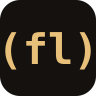

<p align="center">
  
</p>

<h1 align="center">FreeLang</h1>

<p align="center"><strong>사람이 읽고, 모델이 쓰는 Lisp.</strong></p>

<p align="center">
  <a href="https://g-freelang.akl.kr/">Homepage</a> ·
  <a href="https://kimjindol2025.github.io/freelang-ai/">Pages</a> ·
  <a href="examples">Examples</a> ·
  <a href="https://github.com/kimjindol2025/freelang-v11">Compiler</a>
</p>

```freelang
(defn greet [name]
  (str "Hello, " name "!"))

(println (greet "FreeLang"))
```

## Why FreeLang

**작다.** 문법이 한 화면에 담깁니다. 모델이 키워드를 잃어버리지 않습니다.

**코드가 데이터.** Lisp이라서 생성·검사·변환이 같은 모양입니다.

**실제로 돈다.** 함수, 컬렉션, HTTP, DB. 컴파일러는 [freelang-v11](https://github.com/kimjindol2025/freelang-v11)에 있습니다.

## Get started

1. [hello.fl](examples/hello.fl)
2. [factorial.fl](examples/factorial.fl)
3. [collections.fl](examples/collections.fl)
4. [Getting started](docs/getting-started.md)

이 저장소는 언어의 앞문입니다. `src/`, `runtime/`, `tests/`는 여기 없습니다.
